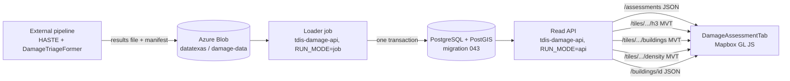

# 01. Architecture and infrastructure

Scope: the "Damage Assessment" map tab. It displays building damage results that an external pipeline (HASTE imagery +
DamageTriageFormer) has already produced. Nothing here runs or changes that pipeline.

## 1. The design in one paragraph

A loader job reads one results file, validates it, computes H3 summaries, and writes an immutable **assessment** into
PostgreSQL/PostGIS in one transaction. A small read-only API returns the list of assessments, one building's details, and
three vector-tile layers generated by SQL functions. The frontend tab adds those three tile sources to a Mapbox map and
switches which layers are visible. All three views are tiles, so payloads are bounded, requests are cached, and the browser
never holds more than the visible area.

## 2. Components



| Component | Where | New or existing |
|---|---|---|
| Tables and tile functions | `tdis-portal-db/migrations/043_create_damage_assessment_tables.sql` (copy in `tdis-damage-api/sql/`) | New |
| Loader job and API | `tdis-damage-api/` (Python, FastAPI, psycopg), one image, two modes like `tdis-ignition-api` | New |
| Tab | `tdis-portal-frontend/src/...` (file 03) | New files, two edited |
| Wildfire code, portal backend | not touched | Existing |

Why a new service and not an extension of `tdis-ignition-api`: that image carries XGBoost, scikit-learn and a 20 MB model and
cold-starts slowly. Tile serving needs none of it and should start in about a second.

Why SQL functions for tiles: the function signature `(z, x, y, aid)` returning `bytea` is exactly what pg_tileserv calls a
function layer. The portal already serves its hazard layers through pg_tileserv, so the same functions can be served by
either the new API or the portal's tile server with no rewrite.

## 3. Data model

One **assessment** = one loaded results file = one event and area at one point in time. It is immutable after publishing.
A correction or a re-run is loaded as a new assessment. This single id replaces both "assessment version" and "AOI id" from
the original plans.

```
damage_assessments                1 ---- n   damage_buildings
  assessment_id  BIGSERIAL PK                  assessment_id  FK, cascade
  event_name     TEXT                          building_id    TEXT
  aoi_name       TEXT                          damage_class   SMALLINT  0..4, NULL = not assessed
  imagery_date   DATE                          damage_pct     REAL      NULL unless supplied and defined
  model          TEXT                          confidence     REAL      NULL unless supplied
  source_file    TEXT                          imagery_ref    TEXT
  data_source    TEXT  'real' | other          assessed_at    TIMESTAMPTZ
  status         TEXT  published | error       geom           geometry(MultiPolygon, 4326)
  error          TEXT                          pt             geometry(Point, 4326)   inside the footprint
  n_buildings, n_assessed, c0..c4  INTEGER     PRIMARY KEY (assessment_id, building_id)
  bbox           geometry(Polygon, 4326)
  created_at, published_at                1 ---- n   damage_h3_cells
                                                 assessment_id  FK, cascade
                                                 res            SMALLINT  4..10
                                                 h3             TEXT      15-character cell id
                                                 n              INTEGER   buildings
                                                 na             INTEGER   assessed buildings
                                                 c0..c4         INTEGER   per-class counts
                                                 dom            SMALLINT  dominant class, NULL if na = 0
                                                 geom           geometry(Polygon, 4326)  the hexagon
                                                 pt             geometry(Point, 4326)    centre of mass of its buildings
                                                 PRIMARY KEY (assessment_id, res, h3)
```

Class codes (the only place labels are mapped is the loader and the frontend config; a test checks they agree):

| Code | Exact label | Colour |
|---|---|---|
| 0 | Undamaged | `#22A65A` |
| 1 | Partial Roof Damage | `#F5D547` |
| 2 | Total Roof Damage | `#F28C28` |
| 3 | Partial Structural Collapse | `#E44747` |
| 4 | Total Structural Collapse | `#991F36` |
| NULL | (not assessed) | neutral grey `#9CA3AF` |

Derived definitions (configuration, to be approved): **damaged** = codes 1 to 4. **severe** = codes 3 and 4.

Only counts are stored. No percentage is stored anywhere, so a wrongly averaged percentage cannot exist.

Indexes:

```sql
CREATE EXTENSION IF NOT EXISTS btree_gist;
CREATE INDEX idx_damage_buildings_geom ON damage_buildings USING gist (assessment_id, geom);
CREATE INDEX idx_damage_h3_cells_geom  ON damage_h3_cells  USING gist (assessment_id, res, geom);
```

`res` must be part of the cell index. Without it a statewide low-zoom tile would scan every fine-resolution cell before
filtering. If `btree_gist` cannot be enabled, use a B-tree on `(assessment_id, res, lat)` with stored `lat`/`lon` columns, the
same approach migration 042 uses.

Rows are loaded in H3 res-10 order so that buildings close on the ground are close on disk. A tile query then reads a few
neighbouring pages instead of scattered ones.

Grants follow migration 042: `ed_app_admin` ALL, `ed_app_user` SELECT and EXECUTE on the three functions.

## 4. API (`tdis-damage-api`, prefix `/api/v1/damage`)

| Endpoint | Returns | Cache-Control |
|---|---|---|
| `GET /assessments` | Published assessments, newest first: id, event, area, bbox, imagery date, model, totals per class, data source | `public, max-age=30` |
| `GET /assessments/{aid}/buildings/{building_id}` | One building's stored fields | `public, max-age=604800, immutable` |
| `GET /tiles/{aid}/h3/{z}/{x}/{y}.mvt` | Layer `h3`: hexagon polygons with `h3, n, na, c0..c4, dom` | same |
| `GET /tiles/{aid}/buildings/{z}/{x}/{y}.mvt` | Layer `buildings`: footprints with `building_id, dc` (`dc = -1` when not assessed). Empty below z14 | same |
| `GET /tiles/{aid}/density/{z}/{x}/{y}.mvt` | Layer `density`: points with weight `w` | same |
| `GET /health` | Service and database state | none |

Rules:

- Tile endpoints run `SELECT damage_<layer>_mvt(z, x, y, aid)` and return the bytes with
  `Content-Type: application/vnd.mapbox-vector-tile`. An empty result returns **204** (the same behaviour as pg_tileserv,
  which the portal's Mapbox code already handles).
- Only `status = 'published'` assessments are served. An unknown or unpublished `aid` returns 404.
- `z`, `x`, `y` are range-checked (`0 <= z <= 16`, `0 <= x,y < 2^z`) before touching the database.
- Responses are gzip-compressed (`GZipMiddleware`).
- Immutable caching is safe because an assessment never changes after publishing. Deleting an old assessment only leaves
  harmless cached tiles.
- No endpoint accepts a free bbox. That is deliberate: it keeps every response cacheable and bounded.

Building detail response:

```json
{
  "assessment_id": 12, "building_id": "TX-0481-000123",
  "damage_class": 3, "damage_label": "Partial Structural Collapse",
  "damage_pct": null, "confidence": 0.87,
  "assessed_at": "2026-10-09T14:20:00Z", "imagery_ref": "haste://...",
  "centroid": [-95.3698, 29.7604],
  "event_name": "...", "imagery_date": "2026-10-08", "model": "DamageTriageFormer-..."
}
```

Fields that were not supplied are `null`, and the panel hides them. Nothing is inferred.

## 5. Loader job

Input: one GeoParquet file (`building_id`, `geometry`, `damage_class` as an exact label or empty, optional `damage_pct`,
`confidence`, `imagery_ref`, `assessed_at`) plus a `manifest.json` (`event_name`, `aoi_name`, `imagery_date`, `model`,
`data_source`). Uploaded to `datatexas / damage-data / assessments /`. The job polls like the wildfire job, or is started
by hand.

Steps (algorithms in file 02):

1. Validate: required columns, CRS (reproject to EPSG:4326), unique `building_id`, labels are one of the five or empty,
   geometry valid (`make_valid`) and non-empty, bounding box inside Texas plus a margin. Any failure rejects the whole file.
2. Compute the representative point of every footprint.
3. Compute H3 cells at res 4 to 10 and the per-cell summaries.
4. In **one transaction**: insert the assessment row, `COPY` buildings, `COPY` cells, run the reconciliation checks
   (file 02, section 7), set `status = 'published'`. If anything fails the transaction rolls back and a separate
   `status = 'error'` row records why. A half-loaded assessment is never visible.
5. Retention: keep the newest `KEEP_ASSESSMENTS` (default 10) published assessments.

A session advisory lock stops two loads overlapping. `batch_jobs` gets one row and is updated STARTED / COMPLETED / FAILED,
as the other jobs do.

`synth_damage.py` generates a fake assessment (random footprints in a chosen area, `data_source = 'synthetic'`) so the
frontend can be built before real data arrives. The tab shows the same amber "test data" banner the wildfire tab uses.

Expected load time, estimate: 2 million buildings in a few minutes on one core (the H3 indexing and the `COPY` dominate).

## 6. Infrastructure

| Item | Requirement | State today |
|---|---|---|
| Database | PostgreSQL 14+, PostGIS 3.1+ (`ST_TileEnvelope` with margin), `btree_gist` | Portal DB has PostGIS (migration 001). The wildfire server `pg-wildfire-tdis` was bootstrapped **without** it |
| Azure extension allow-list | `azure.extensions` must include `POSTGIS,BTREE_GIST` before `CREATE EXTENSION` works | To do |
| Database size | About 450 bytes per building including indexes (estimate): 2 M buildings about 1 GB, 10 M about 4.5 GB | Wildfire server has 32 GB |
| Database compute | Tile generation is CPU work | B1ms (1 burstable vCPU, 2 GB) is enough for a pilot only. Use 2 vCPU general purpose before public use |
| API | Container App, 0.5 vCPU / 1 GiB, **min-replicas 1** | New. The wildfire API uses min-replicas 0; for tiles that means the first map load waits for a cold start |
| Job | Container Apps job, same image, 2 vCPU / 4 GiB | New |
| Registry, identity, storage | `tdiswildfireacr2026`, `id-wildfire-job`, `datatexas` | Reuse |
| CORS | `CORS_ORIGINS` = portal origins | Same as ignition API |
| CDN | Optional. Azure Front Door in front of `/tiles/` if traffic grows; the cache headers already allow it | Later |

Connection pool: 8 connections. A viewport requests about 6 to 12 tiles at once.

Redis is not needed. HTTP caching of immutable tiles does the job with no extra service.

## 7. Performance budgets (to measure, not yet measured)

| Measure | Budget |
|---|---|
| H3 or density tile, server time, warm | p95 under 80 ms |
| Building tile, server time, warm | p95 under 250 ms |
| Any tile, compressed size | under 500 KB; typical under 100 KB |
| Hexagons per tile | at most about 2,200 by construction (file 02, section 3) |
| View switch on already-loaded tiles | under 100 ms, no network |
| Initial tab load to first hexagons | under 2 s on a warm API |

If a building tile breaks the size budget in a dense area, raise the building source `maxzoom` from 14 to 15 (four smaller
tiles instead of one).

## 8. Failure behaviour

| Failure | Result |
|---|---|
| Bad upload | `status = 'error'` row; the published assessments keep being served |
| Database down | API returns 503; the tab shows an error line in its card and the basemap stays usable |
| No published assessment | `/assessments` returns an empty list; the tab shows "No damage assessment has been published yet" |
| One tile fails | Mapbox retries on the next move; the rest of the map is unaffected |
| Building deleted by retention while a user has it selected | Detail returns 404; the panel shows "No longer available" |
